# Architecture – Smart Door Display (MVP)

Companion to `PRD.md` (requirement IDs such as W2, T4, G2 refer to it) and `smart-door-display-mvp.md` (original plan, superseded where `PRD.md` says so). Diagrams are Mermaid and render on GitHub, in VS Code and in most Markdown viewers.

Revision: 2026-10-24, v3. The backend runs on a VPS by default, and the Raspberry Pi hosts a home agent that is the only component that talks to local devices. Section 12 records what the first implementation settled.

## 1. Principles

1. **The backend can live anywhere.** It needs only a public HTTPS URL. Nothing in it assumes the home LAN.
2. **The Pi agent is the only component on the home network that talks to devices.** It connects *out* to the backend; nothing at home listens for the internet.
3. **Clients are thin.** Phone and door screen render state and send intents ("complete task 7", "turn light off"). No business logic, no secrets.
4. **Serve cached data first, refresh in the background.** Every external source has a cache with a `fetchedAt` timestamp; requests never wait on the upstream.
5. **Devices sit behind interfaces at two levels.** The backend knows "devices" and "power" (`DeviceAdapter`); the agent knows protocols (`DeviceDriver`).
6. **One codebase, two layouts.** Phone and wall mode are the same React app with different layouts, served from the same URL.
7. **Push state, don't poll from clients.** The backend pushes change signals over SSE; clients refetch a full snapshot after any reconnect.
8. **Least privilege per credential.** Phone (full), display (read, tick tasks, toggle lights) and agent (device channel only) each get their own token.

## 2. System context

Who talks to whom, and over what.

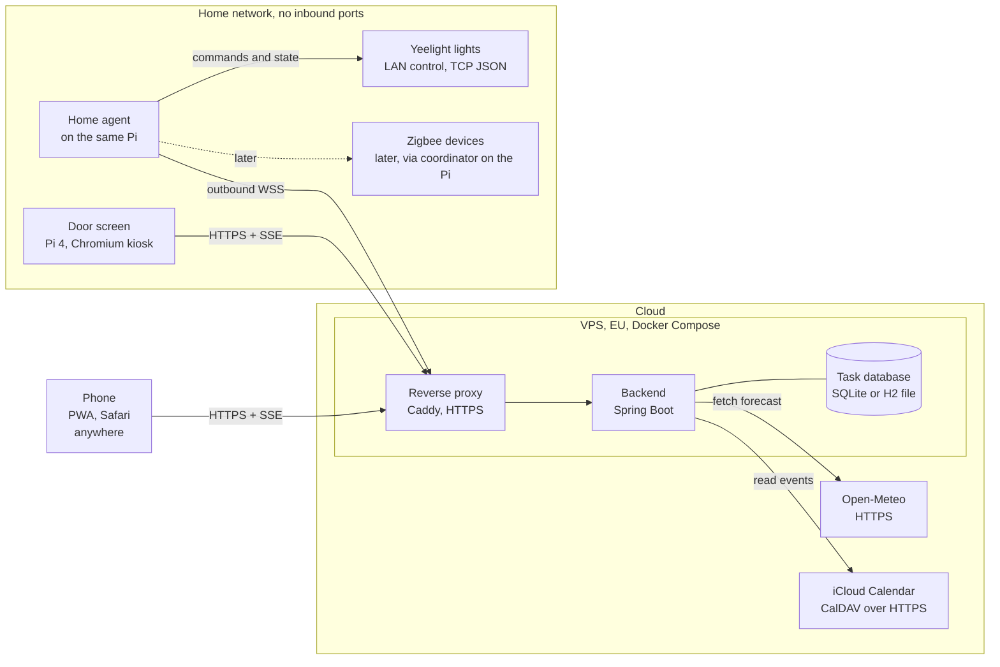

The Pi runs two independent processes: the browser (display) and the agent (gateway). They do not talk to each other in the MVP.

## 3. Component responsibilities

### 3.1 Overview

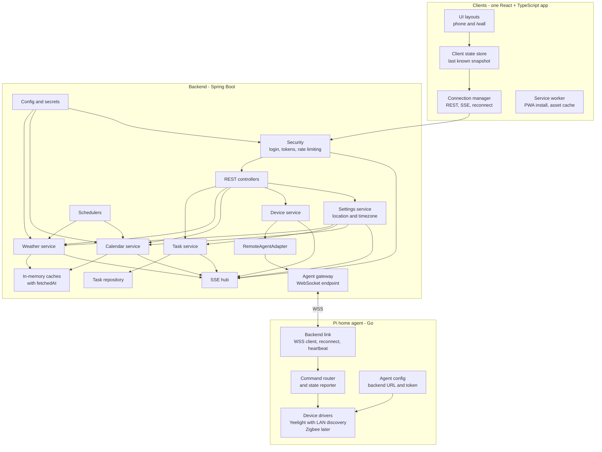

### 3.2 Responsibility table

| Component | Owns | Does **not** do |
| --- | --- | --- |
| **Phone PWA** | Task entry and editing, light control, installable shell | Talk to Apple, Open-Meteo or lights; store secrets |
| **Door screen (Chromium kiosk)** | Showing the wall layout, ticking tasks, toggling lights, showing the reconnecting notice, a local offline page at boot | Run any logic; talk to the agent in the MVP |
| **UI layouts** | Rendering (phone layout, `/wall` layout), touch targets, clock | Fetching directly from services |
| **Client state store** | The last known snapshot of weather, tasks, events and devices; staleness flags | Persisting anything beyond a cache for offline display |
| **Connection manager** | REST calls, the SSE stream, backoff reconnect, full refetch after reconnect, `visibilitychange` handling on iOS | Interpreting business rules |
| **Service worker** | PWA install, caching static assets so the shell loads when the backend is briefly down | Caching API data as truth |
| **Security** | Phone login and session, display pairing (device-code style, QR or typed code) and token, agent token, scope checks, login rate limiting, token revocation | Business logic |
| **REST controllers** | Validation, mapping DTOs, HTTP status codes | Business logic, upstream calls |
| **SSE hub** | Tracking connected clients, broadcasting change events, heartbeats | Holding state; it only forwards "something changed" |
| **Agent gateway** | The `/agent/ws` endpoint: authenticating the agent, holding the single connection, correlating commands with results, heartbeat | Knowing device protocols |
| **Task service / repository** | Task rules ("today's list"), persistence, publishing `tasks` events | Calendar data (tasks live only in the app) |
| **Settings service** | The saved home location (`name`, `latitude`, `longitude`, `timezone`), place search through the Open-Meteo Geocoding API, publishing `settings.changed`, serving the timezone to every service that needs "today" | Forecast fetching; it never invents a default location |
| **Weather service** | Calling Open-Meteo on a schedule with the location from the Settings service, mapping to the app's model, caching, flagging stale data; skipping the fetch when no location is set | Calling upstream during a client request; holding coordinates itself |
| **Calendar service** | CalDAV auth, listing calendars, today's events, all-day handling, finding the next event, caching | Writing to the calendar (read-only) |
| **Device service** | The device registry, last known states, routing commands through the adapter, publishing `devices` events | Knowing protocol details |
| **RemoteAgentAdapter** | Implementing `DeviceAdapter` by sending commands to the agent and waiting for results (5 s limit), marking devices unavailable when the agent is offline | Talking to bulbs |
| **Schedulers** | Timing: weather ~15 min, calendar ~5-10 min, midnight rollover | Business logic (they just call services) |
| **Caches** | Latest good value per source plus `fetchedAt` | Long-term storage |
| **Config and secrets** | iCloud app-specific password, password hash, calendar include-list, deployment values (domain, ports) | Holding location or timezone (those are user settings in the database); being exposed to clients, ever |
| **Agent backend link** | Outbound WSS, auth with the agent token, reconnect with backoff, heartbeat | Inbound listening of any kind |
| **Agent command router / state reporter** | Dispatching commands to the right driver, sending `hello` and `state` messages, polling states every 30-60 s | Business rules, UI concerns |
| **Device drivers** | One per protocol: discover devices, keep the device id to current address map, read state, set power, re-discover when an address stops working, report unreachable | Talking to the backend directly; storing IP addresses anywhere permanent |
| **Agent config** | Backend URL and agent token in a local file on the Pi | Device IP addresses (found by discovery); living in the repo |

## 4. Backend internals

### 4.1 Package layout (proposed)

```
backend/src/main/java/.../homedisplay/
  api/        REST controllers, DTOs, error handling
  security/   login, display pairing, tokens, filters, rate limiting
  stream/     SSE hub, event types
  tasks/      Task entity, repository, service
  settings/   Setting entity, SettingsService, GeocodingClient (Open-Meteo Geocoding)
  weather/    OpenMeteoClient, WeatherService, WeatherModel
  calendar/   CalDavClient, CalendarService, EventModel
  devices/    DeviceService, DeviceAdapter, Device, DeviceState,
              DeviceRepository + DeviceInventory (stored devices, quick access)
  rooms/      Room, RoomRepository, RoomService
    agent/    AgentGateway (WebSocket), RemoteAgentAdapter, protocol messages
  schedule/   scheduled jobs
  config/     typed @ConfigurationProperties, clock bean

agent/                         Go module, one static binary
  cmd/agent/       main.go: wiring, signal handling
  internal/link/   WebSocket client, reconnect, heartbeat, protocol messages
  internal/drivers/
    driver.go      DeviceDriver interface
    yeelight/      discovery (multicast), connection per bulb, id -> address map
    (zigbee/       later)
  internal/config/ loads the local config file (backend URL, token)
```

Dependency rule: `api` depends on the services; services depend on clients, adapters and repositories; nothing depends on `api`. Services publish events to `stream` through a small `ChangePublisher` interface so they stay testable. A fake `DeviceAdapter` lets the UI be built before the agent exists.

### 4.2 Class view of the device layers (the extension point)

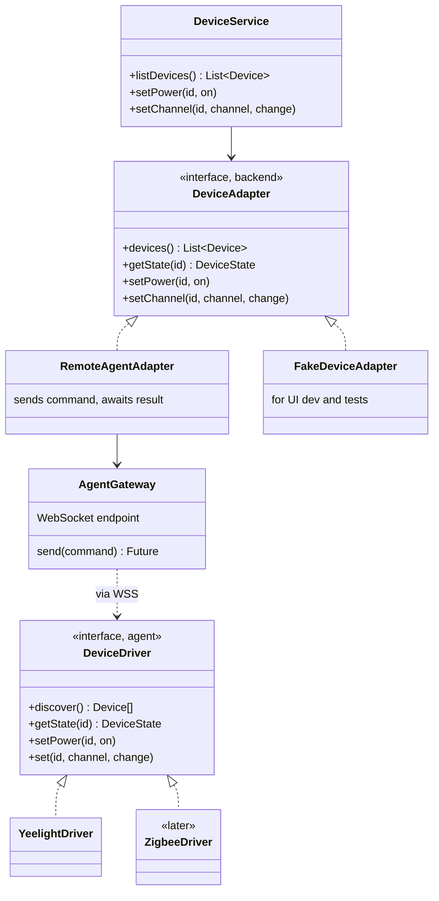

Adding Zigbee means adding one `ZigbeeDriver` in the agent. The backend, API, SSE events and UI do not change (L4): a device is a list of channels, and the UI is driven by each channel's capabilities, never by the protocol behind it (D1-D2).

## 5. Data model

Persisted: tasks, settings, credentials and, for the home organisation, rooms, devices and quick-access slots. Everything else is a cache rebuilt from upstream (or from the agent's `hello`) after a restart. Credentials are stored as hashes, not as tokens.

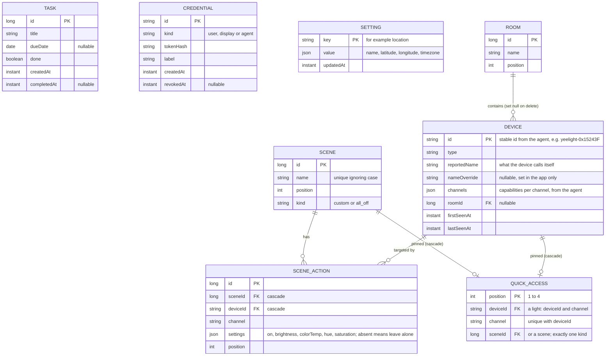

`CREDENTIAL` holds user, display and agent tokens (hashed, revocable). `SETTING` is a small key-value table; the `location` row holds the home location chosen in the app (no row means "not set yet").

**Devices.** The agent decides which devices exist and reports their live state. The `DEVICE` table is an inventory plus the user's organisation of it: it is filled by a `DevicesDiscoveredEvent` whenever the agent reports devices (first seen, last seen, reported name) and never stores power or reachability, which change every few seconds and are owned by the agent. A device the agent stops reporting keeps its row, so it stays in its room as unavailable; only the user can forget it. Because the primary key is the agent's stable id (not an IP), an assignment survives address changes. `DEVICE.channels` holds each channel's capabilities as reported by the agent (live channel state is not stored), so controls and pinned tiles exist while the bulb is offline. `QUICK_ACCESS` has one row per pinned slot; the primary key on `position` with a check `position between 1 and 4` makes the limit of four a database rule, and `(deviceId, channel)` is unique so a channel is pinned once. A slot pins a channel, so a light bar's main and background lights can be two tiles, or a scene.

**Scenes.** A scene is a row plus ordered `SCENE_ACTION` rows. An action stores only the settings that are included (the JSON has no entry for a setting left alone), which is what makes "set the colour, keep the brightness" possible. The built-in `All off` scene is a row with `kind = all_off` and no actions; its effect is computed when it is applied. There is no `HOME` table: this is a single household, so rooms are top-level.

In-memory cache shapes (not persisted):

| Cache | Content | Refresh |
| --- | --- | --- |
| Weather | current + today's forecast, `fetchedAt` | ~15 min |
| Calendar | today's events, next-event id, `fetchedAt` | ~5-10 min, also at midnight rollover |
| Device state | per device: power, reachable, `updatedAt`; agent online flag. Merged with the stored devices on read | pushed by the agent (poll 30-60 s on its side, plus after each command) |

## 6. Flows

### 6.1 Client startup and live connection

The same sequence for the phone and the Pi after boot (credentials are already present).

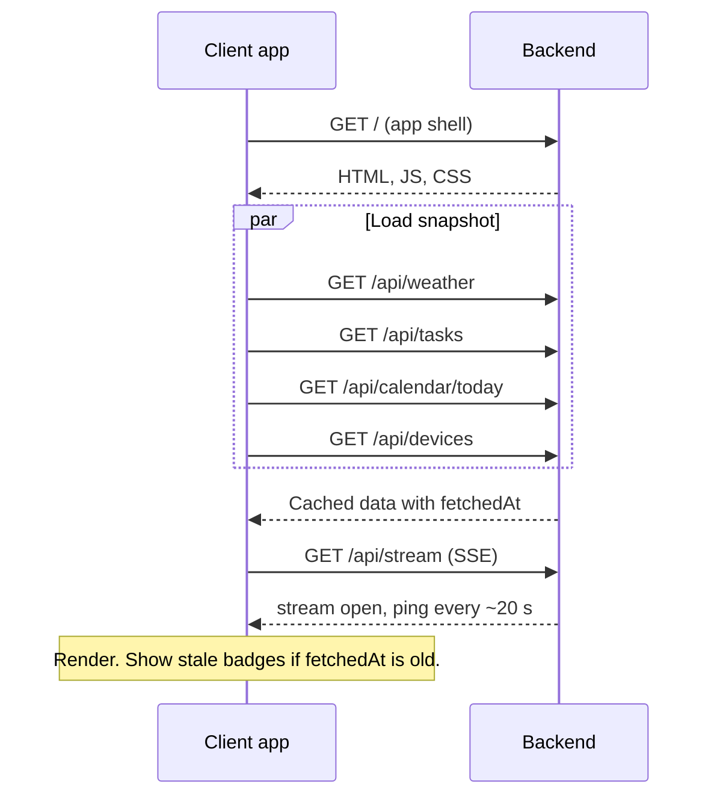

### 6.2 Sign-in and display pairing (A2, A3, A3a, A3b)

Pairing starts on the display, because the Pi has no keyboard or camera. The user finishes it on the phone either by scanning the QR code or by typing the short code.

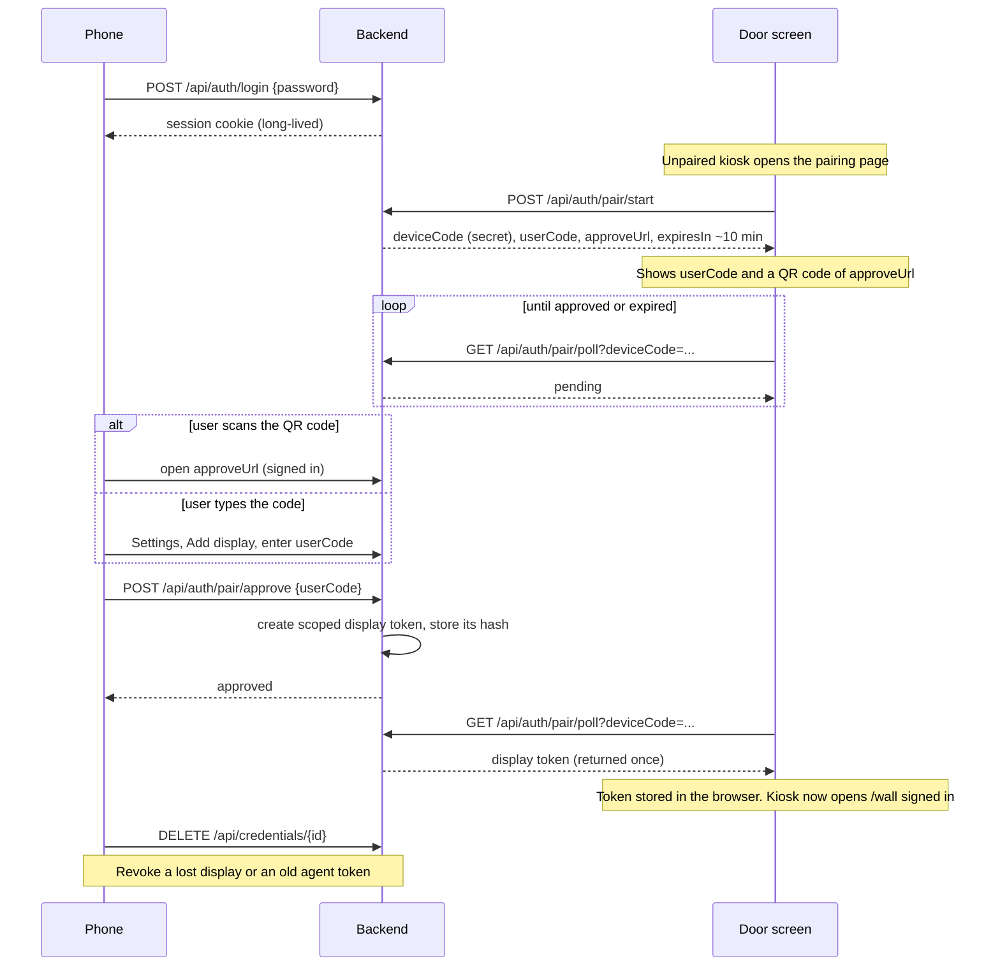

Safety rules: the QR code and `userCode` are useless without the secret `deviceCode`, which only the display knows; codes expire, work once, are rate-limited and compared in constant time; the display token is handed over exactly once.

### 6.3 Task created on the phone, appears on the door screen (T1, T4)

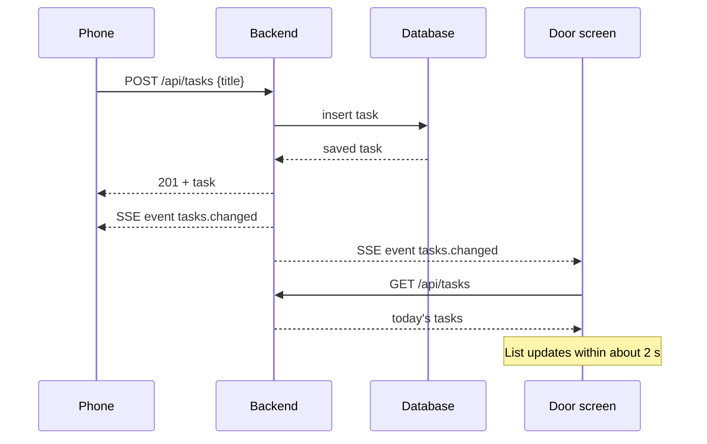

Events carry only "what changed", so clients refetch the small payload instead of merging deltas.

### 6.4 Agent connects (G2, G3)

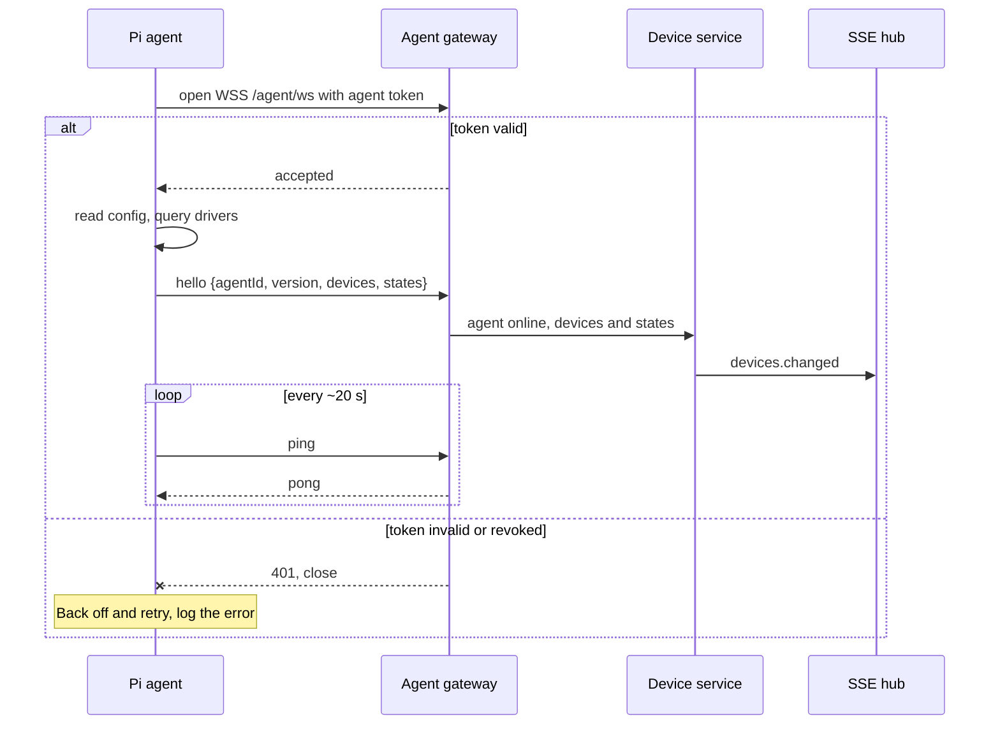

### 6.5 Light toggled from the door screen (L1, L2, L3, L7)

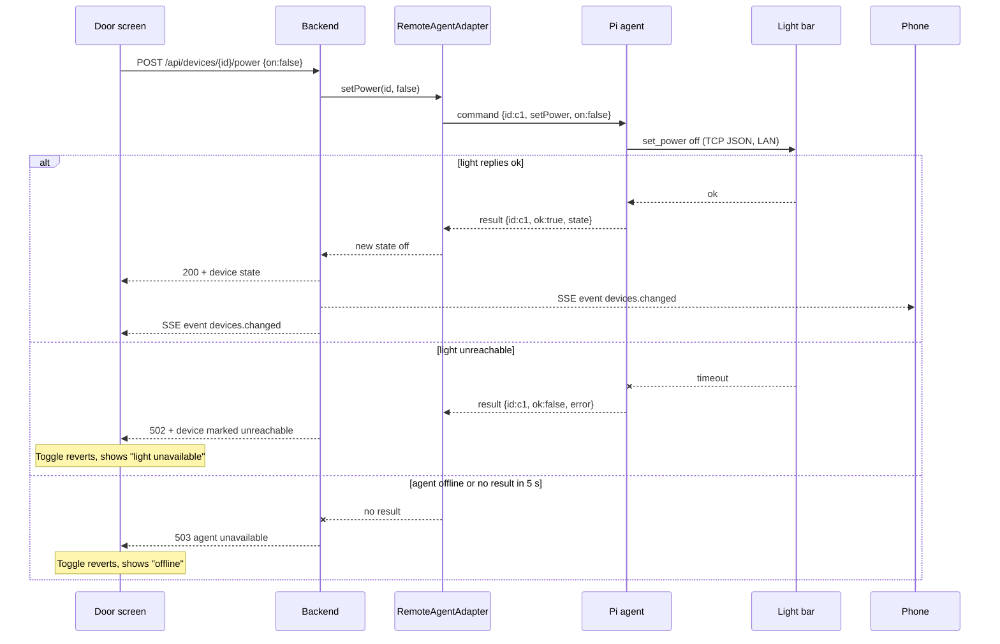

The UI may toggle optimistically but must revert on failure. The same flow applies for the phone, wherever it is.

### 6.6 Weather refresh (W2, O3)

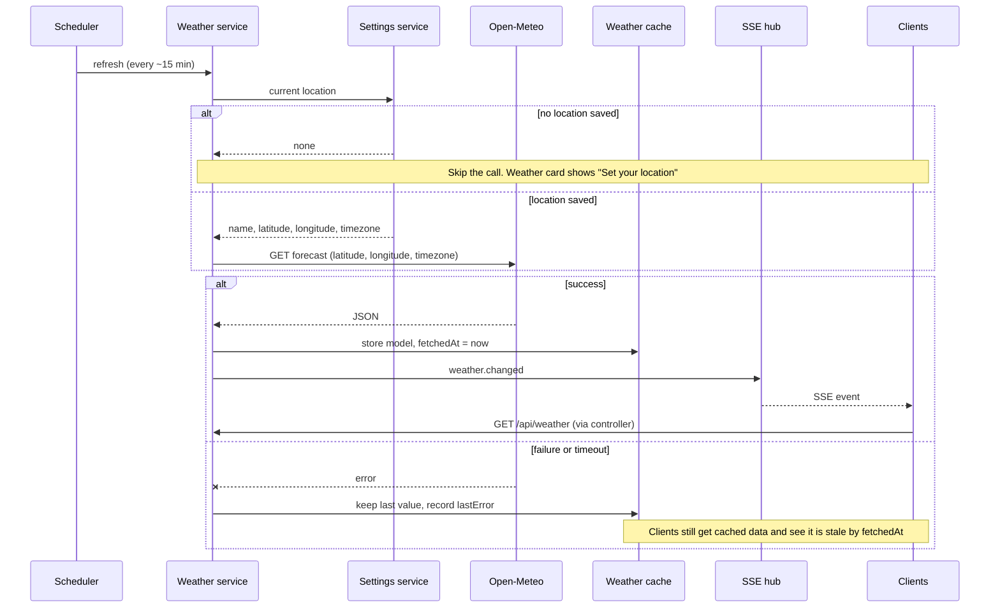

### 6.7 Calendar refresh (C1-C4)

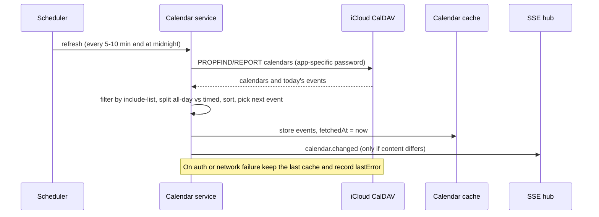

The "next event" highlight is recomputed on read using the current time, so it stays right between refreshes.

### 6.8 Connection loss and recovery on the door screen (O1, O2, M5)

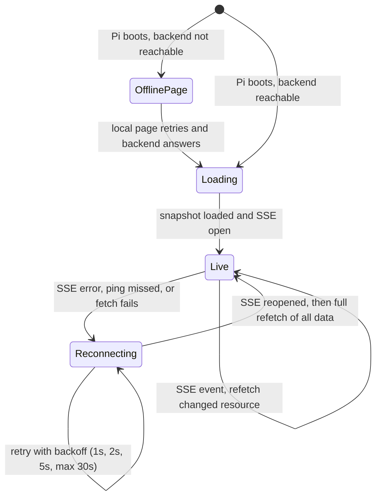

While in `Reconnecting` the UI keeps rendering the last snapshot, shows a "reconnecting" notice and disables light toggles (O4); the page is never reloaded or blanked. Reaching `Live` always triggers a full refetch so missed events do not matter. `OfflinePage` is a tiny static page stored on the Pi that polls the backend URL.

### 6.9 Agent link states (G2, G8)

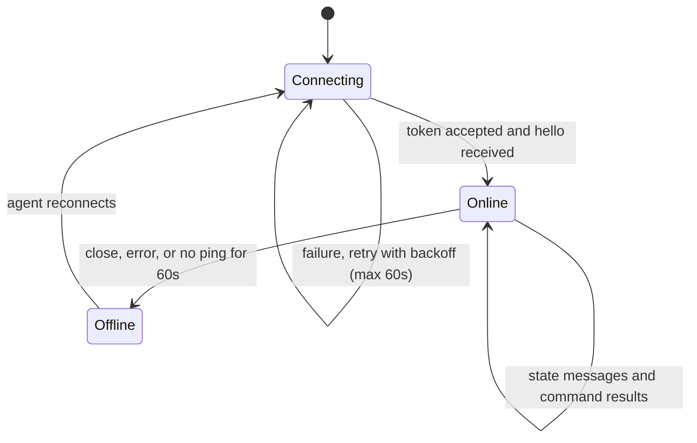

Backend view: in `Offline` all devices are shown "unavailable" with their last known state, and commands fail fast with 503.

### 6.10 Failure isolation

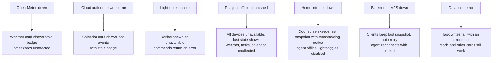

### 6.11 Setting the home location (S1-S3, W7)

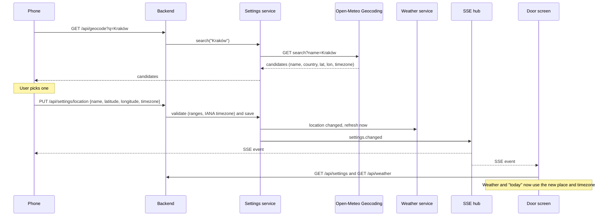

The timezone changes what "today" means, so on a location change the backend also recomputes the today views of tasks and calendar and refreshes the calendar. Both come from the same saved timezone, so the system never disagrees with itself about the date.

### 6.12 Device discovery and address changes (G9, G10, G12)

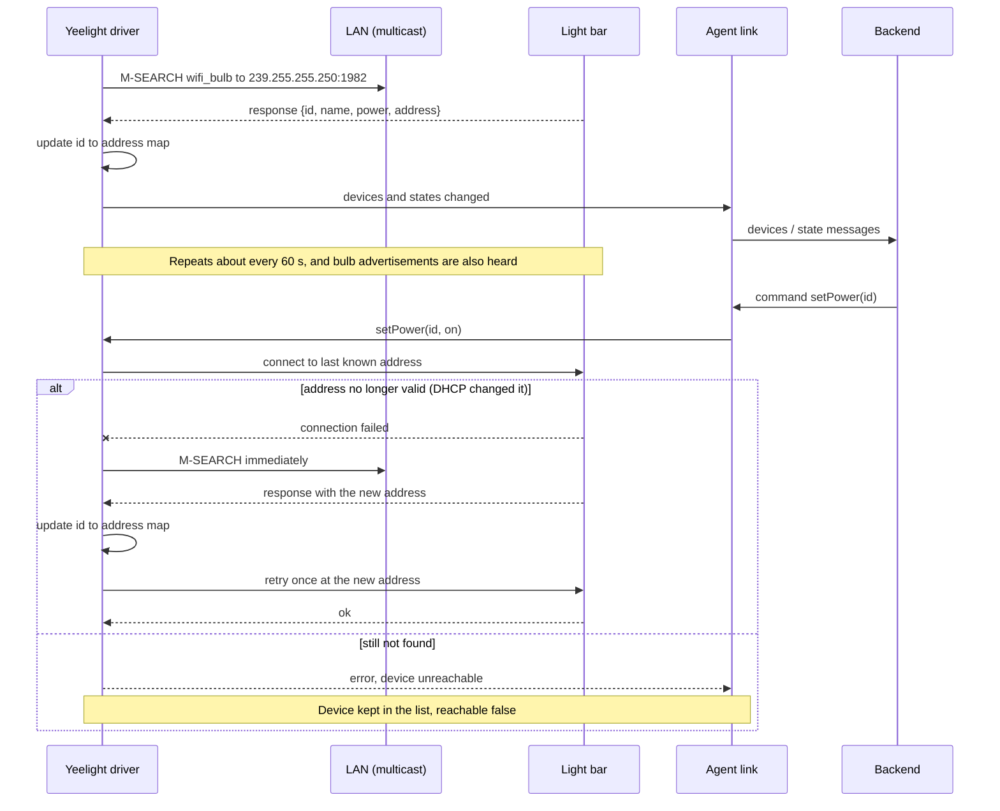

Devices are always identified by their stable id; IP addresses exist only inside the driver at runtime.

### 6.13 New device, rooms and quick access (R1-R12)

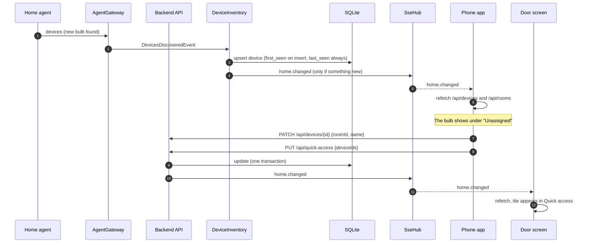

Reads merge two sources: `DeviceRepository` (what exists and how it is organised) and the `DeviceAdapter` (live power and reachability). A stored device with no live entry is returned as unreachable. This is also what makes the structure visible right after a backend restart, before the agent has reconnected (R11).

Write rules: only the user credential may change rooms, assignments, names and quick access; the display may toggle power as before. Setting quick access replaces all slots in one transaction, rejects more than four, duplicates and unknown ids, and the same call is how a device is unpinned or reordered. Deleting a room sets `room_id` to null on its devices; forgetting a device removes its row and, through the cascade, its quick-access slot.

### 6.14 Setting brightness or colour (D1-D9)

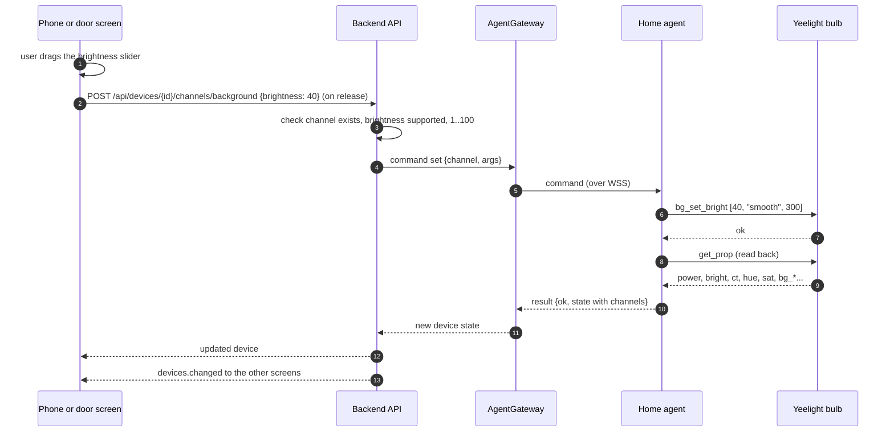

Capabilities travel agent to backend only: the agent builds them from the bulb's discovery answer (`support` list: `set_bright`, `set_ct_abx`, `set_hsv`, and the `bg_` variants for a background light) plus a model table for the colour temperature range, and the backend validates against them (400 for an unsupported or out-of-range value). The agent still refuses what the bulb cannot do, so a stale backend cannot send a bad command. Sliders send on release because Yeelight accepts about 60 commands a minute per bulb; the agent also spaces commands 250 ms apart. For a change with several fields the agent sends them in a fixed order: power, brightness, then temperature or colour.

### 6.15 Applying a scene (SC3-SC4, SC7)

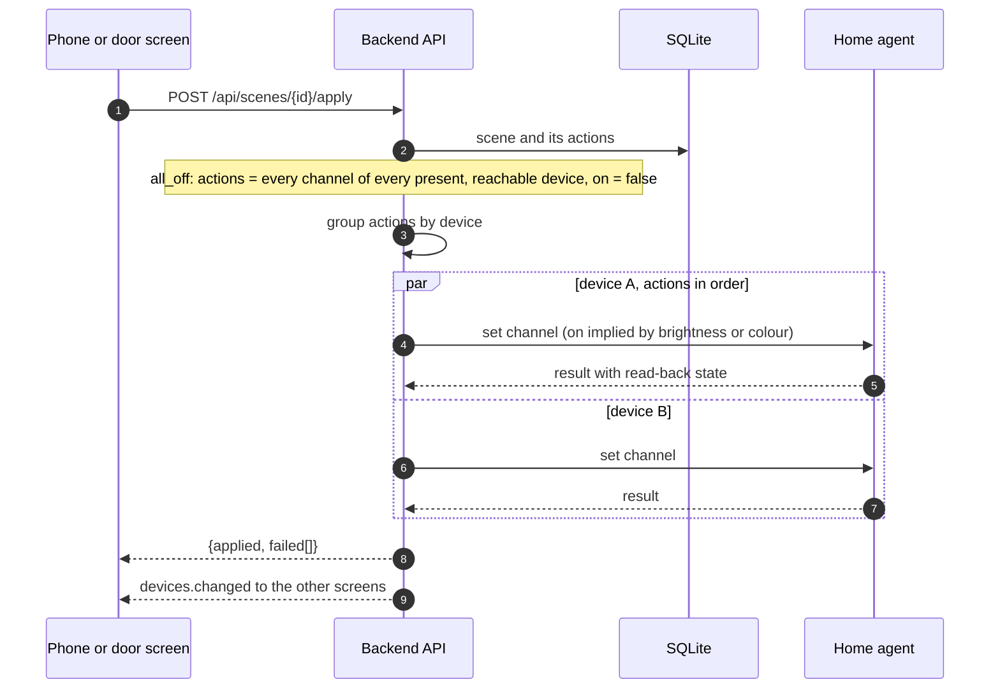

An action's stored settings are turned into the change that is sent: if it sets brightness, white or colour and does not mention power, power is added as `on: true`; `on: false` drops the other settings. Each change is validated against the channel's current capabilities first, so a light that no longer supports a stored setting fails that action with a reason instead of being sent. A command error never aborts the scene: it is recorded for that action and the others continue. If the agent is offline the call fails with 503 before anything is sent. **Capture** reads each chosen light's live values from the merged device state (on or off; when on, brightness and either the white or the colour it is currently showing) and stores them as an ordinary scene.

## 7. API and event contract

REST endpoints and credentials are listed in `PRD.md` section 6. SSE and the agent protocol are below.

### SSE events (backend to clients)

| Event name | Meaning | Client reaction |
| --- | --- | --- |
| `tasks.changed` | Task list changed | `GET /api/tasks` |
| `devices.changed` | Any device state or agent availability changed | `GET /api/devices` |
| `home.changed` | Rooms, assignments, names, quick access or the set of known devices changed | `GET /api/rooms` and `GET /api/devices` |
| `weather.changed` | New weather cached | `GET /api/weather` |
| `calendar.changed` | New calendar content | `GET /api/calendar/today` |
| `settings.changed` | Location or other settings changed | `GET /api/settings`, then refetch weather, tasks and calendar |
| `ping` | Heartbeat about every 20 s | Reset the stale-connection timer; none for ~60 s means the connection is lost |

Every data response includes `fetchedAt` (or `updatedAt`) and a `stale` flag, set when the age exceeds a threshold (for example 2x the refresh interval). `GET /api/devices` also includes `agentOnline`.

### Agent WebSocket messages (JSON)

| Direction | Message | Fields |
| --- | --- | --- |
| agent → backend | `hello` | `agentId`, `version`, `devices[]`, `states[]` |
| agent → backend | `devices` | full list of known devices (`deviceId`, `name`, `type`, `channels[]` with `id`, `label`, `capabilities`), sent when discovery finds or loses a device |
| agent → backend | `state` | `deviceId`, `power` (any channel on), `reachable`, `updatedAt`, `channels[]` (`id`, `on`, `brightness?`, `colorTemp?`, `hue?`, `saturation?`, `colorMode?`) |
| backend → agent | `command` | `id`, `deviceId`, `action` (`setPower` for the whole device, or `set` with `channel` and `args`) |
| agent → backend | `result` | `id`, `ok`, `error?`, `state?` |
| both | `ping` / `pong` | heartbeat every ~20 s |

The channel fields are additions to protocol version 1 and are all optional: an agent without them is treated as a single power-only `main` channel, and an agent that does not know `set` answers with an error result.

Rules: the backend accepts one agent connection at a time (a new valid connection replaces the old one); every `command` gets exactly one `result` or times out after 5 s; unknown message types are ignored and logged; messages carry a `v` protocol version field so the agent and backend can be upgraded independently.

## 8. Deployment

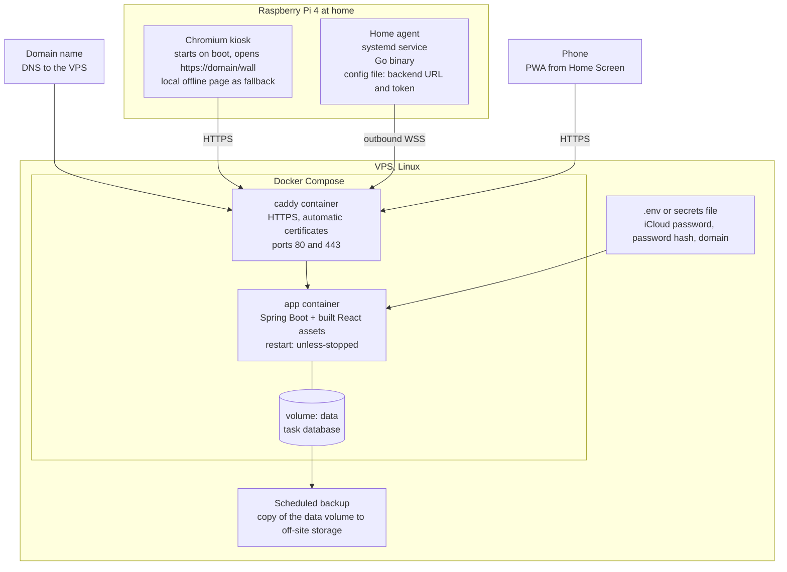

- **Single app image:** the Vite build is copied into Spring's static resources, so there is one URL and no separate web server for the app. Caddy only terminates HTTPS and proxies.
- **VPS firewall:** open only 80/443 (and SSH with key-only login, ideally restricted by IP). The home router needs no changes.
- **Pi:** a systemd unit for the agent (restart on failure) and an autostart entry for Chromium kiosk; both start at boot. Avoid frequent disk writes on the SD card (logs to RAM or journald limits).
- **Portability:** the same Compose file runs on a laptop or a home server for development; only the domain/proxy section differs.
- **Dev setup:** during phase 3-4 you can run the backend on a laptop and point the Pi and phone at it before the VPS exists.

## 9. Cross-cutting concerns

| Concern | Approach |
| --- | --- |
| **Secrets** | Server env/secrets file loaded into typed config; agent token in the Pi's config file; tokens stored hashed; nothing logged, nothing sent to clients, nothing committed |
| **Authentication** | Single-user password login with a hashed password and rate limiting; display token from one-time pairing; agent token; scope checked on every endpoint; revocation supported |
| **Transport** | HTTPS everywhere; agent uses WSS; SSE uses same-origin cookies or the display token header |
| **Time and location** | One injected `Clock` and one timezone, read from the saved location setting (nothing hard-coded). Until a location is saved, the server's own timezone is the fallback and weather is off. "Today" is computed on the server in that timezone; midnight rollover (in that zone) triggers calendar and task view refresh. The timezone value is validated as an IANA zone on save |
| **Observability** | Structured logs, `/api/health` for liveness (public: up/down only), an authenticated status view with per-source `lastSuccess`, `lastError`, agent online |
| **Resilience** | Timeouts on every upstream call, one in-flight refresh per source, keep last good value on failure, backoff everywhere, 5 s command timeout |
| **Rate limits** | Open-Meteo is cached, so about 100 calls a day, far under the ~10,000 limit |
| **Testing** | Unit tests for services with fake clients/adapters; contract tests for the REST API and the agent protocol; a fake `DeviceAdapter` and a fake agent for UI and backend work without lights |
| **Pi performance** | Pi 4 with 2 GB: light wall layout, no heavy animation; agent stays well under ~150 MB |
| **Versioning** | Protocol version field on agent messages; agent and backend deployable independently |

## 10. Decisions log

| Decision | Choice | Alternatives and reason |
| --- | --- | --- |
| Backend location | VPS by default, location-independent | Home server: needs hardware and a VPN for remote access; still supported because the agent connects out |
| Local device access | Pi home agent connecting out over WSS | Backend talking to the LAN: needs a VPN or open port when hosted away from home |
| Agent link | WebSocket (bidirectional, one connection) | MQTT: adds a broker; polling: higher latency |
| Agent runtime | Go, single static binary | Node.js: shares a language with the frontend but needs a runtime and more RAM; Spring Boot: too heavy for a 2 GB Pi sharing RAM with Chromium |
| Device addressing | Stable device id plus runtime discovery; no IPs in config | Fixed IPs: break whenever DHCP hands a bulb a new address |
| Display pairing | Display-initiated device code, finished by QR scan or typed code | Phone-initiated code typed on the Pi: needs an on-screen keyboard on a kiosk |
| Device state updates | Polling by the agent (30-60 s) | Yeelight pushed property notifications: lower latency, more connection handling; parked for later |
| HTTPS | Caddy with automatic certificates | Self-managed nginx + certbot: more manual steps |
| Location and timezone | User setting in the database, chosen by place search (Open-Meteo Geocoding), no default | Env/config values: hard-coded per deployment and need a redeploy to change; browser geolocation only: no timezone name and no label |
| Auth | Password login (phone), pairing token (display), agent token | Passkeys: nicer but more work; defer |
| Live updates | SSE | WebSocket is unnecessary for clients; commands go through REST |
| Event style | "changed" signal, then refetch | Delta merging adds client complexity and drift risk |
| Task storage | SQLite or H2 file | Postgres is overkill for one user |
| Hosting | Docker Compose on the VPS | K3s: no benefit for one container |
| Frontend delivery | Static assets served by the backend | Separate web server or CDN is not needed at this scale |
| Device organisation | Rooms, assignments, names and quick access stored in the backend database, keyed by the agent's stable device id | In the agent's config on the Pi: the agent has no UI and the phone must be able to edit it; as one JSON blob in `setting`: no integrity for dangling ids |
| Live device state | Not stored; merged on read from the agent's reports | Persisting power and reachability: stale within seconds and a second source of truth |
| Home entity | None; rooms are top-level | A `home` table: only needed for several households, which is out of scope |
| Rooms vs. tags | One room per device (nullable foreign key) | Many-to-many tags: more flexible but harder to present and explain |
| Quick access | Separate table with a four-slot primary key | A `pinned` flag on `device`: the limit and the order would live in application code only |
| Device model | Device has channels; each channel has capabilities and state | Flat Yeelight-specific fields (`bgBrightness`...): break for any other device; one entity per light as separate devices: loses the grouping under one bulb |
| Capability source | Agent derives them from the device; backend stores and validates against them | Hard-coded model tables in the backend or UI: spreads protocol knowledge outside the driver |
| Command shape | One `set` command with a partial change per channel | One command per property: more round trips and a quota hit for each |
| Slider commits | On release | Throttled live dragging: 60 commands a minute per bulb is easy to exceed |
| Quick access pins | A channel | A whole device: cannot show main and background as separate tiles |
| Scene model | Named list of per-channel actions across devices, settings individually optional | Snapshot of whole device states: cannot leave a setting alone; one scene per room or device: cannot span devices |
| Scene apply | Backend fans out ordinary `set` commands, parallel across devices, no rollback, partial failures reported | A new batch message to the agent: fewer round trips but a protocol change; rollback: needs state capture and can itself fail |
| All off | Built-in scene computed at apply time | Stored actions: new lights would be missed |
| Calendar access | Read-only CalDAV with an app-specific password | Apple has no public calendar API for web backends |

## 11. Open architecture questions

1. VPS provider, region, size and domain (nothing chosen yet).
2. ~~Display pairing UX~~ Decided: display-initiated, user chooses to scan the QR code or type the code (section 6.2). Still open: how the kiosk shows the pairing page before it holds a token (a route that is public but shows nothing sensitive).
3. ~~Agent language~~ Decided: Go.
4. ~~Yeelight addressing~~ Decided: discovery, not fixed IPs (section 6.12). Still open: whether the Pi's network passes multicast between the Pi and the bulbs; check early in phase 5.
5. ~~Yeelight state updates~~ Decided: polling for now; pushed property notifications parked for after the MVP.
6. ~~SQLite vs. H2 file~~ Decided: SQLite.
7. Local-first lights (parked): letting the kiosk talk to the agent on the LAN so lights work without internet. The agent could expose a tiny local-only API later without changing the cloud design.

## 12. Implementation notes

- **Stack as built:** Spring Boot 4.1.2 on Java 25 (Jackson 3), SQLite through Spring `JdbcClient` and Flyway, React 19 with TanStack Query, Go 1.25 with `coder/websocket`.
- **One mechanism for all credentials:** every client (phone, display, agent) presents a random token whose SHA-256 hash is in the `credential` table. Browsers get it as an HttpOnly, SameSite=Lax cookie (the display receives its cookie from the pairing poll, so the token never passes through page scripts); the agent sends it as a bearer token. A writes-must-be-same-origin filter backs up the cookie's SameSite setting.
- **Client data flow:** TanStack Query caches each resource. An SSE event invalidates the matching query, and every (re)connect invalidates everything. Because queries keep their last data when a refetch fails, the "reconnecting" state needs no extra storage.
- **Device layers as built:** `FakeDeviceAdapter` (dev) or `RemoteAgentAdapter` + `AgentGateway` + `AgentRegistry` (agent mode) in the backend; `DeviceDriver` with a Yeelight driver in the agent. The Yeelight driver searches by multicast, keeps an id-to-address map, re-searches and retries once when a command cannot reach a bulb, and opens a short-lived connection per command.
- **Calendar as built:** `CalendarSource` has `off`, `fake` and `caldav` implementations. The CalDAV source discovers principal, calendar home and calendars (cached one hour), queries each calendar by time range, and `ICalExpander` (ical4j) expands recurring events, handling excluded dates, moved and cancelled occurrences.
- **Not covered by automated tests:** real Yeelight bulbs, a real iCloud account, multicast on a real network, the Pi kiosk, and a live VPS deployment.
- **Rooms and quick access as built:** migration `V2__rooms_and_devices.sql` adds `room`, `device` and `quick_access`. `DeviceInventory` listens for `DevicesDiscoveredEvent` (published by `AgentGateway` on `hello` and on every device list, and by `FakeDeviceAdapter` at startup) and upserts the devices; it publishes `home.changed` only when a device is new or its reported name or type changed. `DeviceService.snapshot()` returns the stored devices merged with live state from the adapter (`present` is false for a stored device the agent does not list). A device the user forgot disappears from the list until the agent reports it again (on its next `hello` or device-list message). The test database enables `foreign_keys` like production, because the schema relies on `on delete set null` and `on delete cascade`.
- **Home tab as built:** the phone has a bottom tab bar (Dashboard, Home). `homeModel.ts` holds the pure grouping, ordering and availability logic (unit-tested). Edit mode on the Home tab covers rooms (add, rename, move, delete), assigning a device to a room, renaming, pinning and ordering quick access, and forgetting a missing device. The wall screen shows the Quick access panel; its "All devices" button switches the wall to `WallDevices`, a toggle-only list of rooms and devices (the same `DeviceRow` as the phone, without edit mode). `useIdle` returns it to the dashboard after 30 s without a touch. The wall stays one route and one piece of local state, not a router with tabs.
- **Channels as built:** `drivers.Channel` (capabilities) and `drivers.ChannelState` in the agent; `Change.Check` refuses unsupported or out-of-range changes before anything reaches the bulb. The Yeelight driver builds channels from the discovery `support` list (`bg_set_power` means a background light), asks `get_prop` for six properties per channel (`power`, `bright`, `ct`, `hue`, `sat`, `color_mode`, with `bg_` names for the background light), and sends `set_power`, `set_bright`, `set_ct_abx`, `set_hsv` (with `bg_` prefixes) with a 300 ms transition. After a command the agent reads the device back and puts that state in the command result; if the read-back fails it applies the command to the previous state instead.
- **Backend channels:** `V3__device_channels.sql` adds `device.channels` (JSON capabilities) and rebuilds `quick_access` with a `channel` column. `Device` carries `channels` and `states`; an agent that reports no channels gets a single power-only `main` channel. `ChannelChange.validate` implements the 400 rules; `AgentRegistry` merges reported channel states and applies commands optimistically only when a result carries no state.
- **Device panel:** `DevicePanel` and `ChannelControls` are driven by each channel's capabilities. `Slider` commits on release and keeps the dragged value until the request and the refetch finish. Quick access tiles toggle on tap and open the panel on a 500 ms hold. On the wall the panel and the All devices view share the 30 s idle return.
- **Yeelight lamp15 quirk:** on the Monitor Light Bar Pro (firmware 38) `bg_set_power "on"` and `bg_toggle` answer `ok` but leave the background light off, while `bg_set_power "off"` works and `bg_set_scene` switches it on. The driver therefore turns the background light on with `bg_set_scene` (when the bulb lists it in `support`), reading the light's last colour or white and brightness first and letting the change's own values override them; everything else uses the plain commands. Found by probing the real bar; the same driver code was run against it afterwards.
- **Scenes as built:** `V4__scenes.sql` adds `scene` and `scene_action`, seeds the built-in `All off` row (`kind = all_off`) and rebuilds `quick_access` so a slot holds a light or a scene (a check enforces exactly one). `SceneService` validates actions against the stored capabilities, applies a scene by grouping actions per device and running each group on its own virtual thread (the groups in parallel, the actions of a device in order), and returns `{applied, failed[]}`; `capture` reads the merged device state (`currentSettings`: off, or on with brightness and either colour or white). Settings are stored as the JSON of a `ChannelChange`, so a setting left alone is simply absent.
- **Scene UI:** `ScenesSection` (apply grid, or manage list with pin, order, edit, delete), `SceneEditor` (a block per light with a checkbox per setting, white and colour exclusive), `CaptureDialog` (name and which lights), and scene tiles in `QuickAccessCard`. The editing model (`sceneModel.ts`: drafts, include flags, conversion to the request) is pure and unit-tested.
- **Visual design:** the interface follows Apple's iOS and Home app conventions. `styles.css` defines the tokens (system blue, green, red and orange, the grouped grey canvas and white or dark cards, translucent fills, hairline separators, continuous 20-26 px corners, the `-apple-system` font stack) for light and dark; the wall forces dark. Components: large page titles, small capitalised card headings, an iOS switch (green, white knob), thick Home-style sliders (the `--pf` custom property set by `Slider` fills the track up to the handle; the white and colour sliders keep their gradients), a segmented control, round Reminders-style task checks, Home-app tiles (grey when off, white when on, bulb or sparkle icon), a translucent tab bar and centred sheets with a blurred scrim. The weather card has a day or night sky. The wall avoids blur effects because they are expensive on a Raspberry Pi. Colours that must work in both themes go through tokens, so a theme change needs no component changes.
- **Yeelight lamp15, main light and device power:** `power` is the power of the **device** (on when any light is on); the bar also reports **`main_power`**, the main light alone. The driver reads `main_power` for the main channel's state, so a bar that is in its *background-only* mode (power on, `main_power` off) shows the main light off. Measured on the real bar: `set_power off` switches the whole device off when both lights are on, but is a no-op when only the background glows; `set_power on` turns the main light on and keeps the background; `bg_set_power on` is ignored; `bg_set_scene` switches the background on and, from "everything off", leaves the main light off. "Main off, background on" is therefore built as: read the background's colour and brightness, `set_power off`, then `bg_set_scene` with those values (`mainOff`). A device-wide off switches the background off first, so it is not lit again for nothing. A main-off on a bar that reports no `main_power`, or whose background is off, is a plain `set_power off`.
