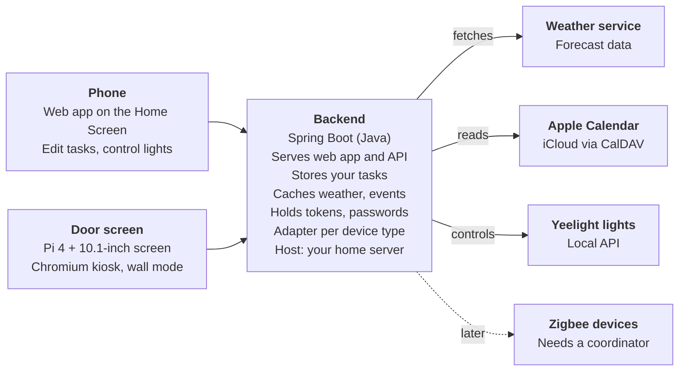

# Smart Door Display – MVP

*24 Oct 2026 · Kuba*

## Goal

Build one web app that shows today's weather, tasks and calendar events and controls your lights, then run it on your phone and on a 10.1" touchscreen hung next to the door.

**MVP success test:** before leaving in the morning, you read the weather, your tasks and your next calendar events on the door screen and switch the lights off from it, without opening your phone.

## Scope

The MVP covers four data sources and one shared app; everything that needs more hardware or a native app waits.

**In the MVP**

- Weather: current conditions and today's forecast
- Tasks for the day, created and completed in the app and stored in the backend
- Apple Calendar events, read-only, through CalDAV
- Yeelight control from phone and screen, built on a device layer that can take Zigbee devices later
- One web app: installable on the phone, opened full screen on the Pi ("wall mode")
- A Spring Boot (Java) backend on your home server, not on the Pi

**Left out for now**

- Zigbee devices: they need a Zigbee coordinator, so the MVP only prepares the device layer
- Motion sensor that wakes and dims the screen
- Transit and commute info
- Household notes board
- Native iPhone app and push notifications
- Apple Reminders integration

## Hardware and budget

The build costs about €210-225 with a Raspberry Pi 4 and the Waveshare 10.1" capacitive touchscreen. Prices are from 24 Oct 2026; "~" marks my estimates.

| Part | Role | Cost (EUR) |
| --- | --- | --- |
| Raspberry Pi 4, 2GB | Runs the browser that shows the app | ~60 ($67.50 list since 1 Oct, [source](https://www.omgubuntu.co.uk/2026/10/raspberry-pi-2gb-costs-how-much-now)) |
| Waveshare 10.1" capacitive touchscreen, 1280×800, HDMI + USB touch | The door display; the kit includes HDMI and USB cables and a back stand ([source](https://eu.robotshop.com/products/waveshare-101-capacitive-touch-screen-lcd-b-w-case-1280800-hdmi-ips-low-power-eu)) | 122.09 |
| USB-C power supply, 5V/3A | Powers the Pi | ~12 |
| microSD card, 32GB | Pi system storage | ~8 |
| 5V USB charger | Powers the display separately | ~5-8 |
| Wall mount or frame | Holds the screen by the door | ~5-10 |
| **Total** | | **~210-225** |

Later: a PIR motion sensor (~3-5) plus jumper wires (~2) to wake the screen when you walk past. You already own the Yeelight light bar; the outlet by the door is confirmed and the Pi needs Wi-Fi in range.

**Not in the total:** the home server, with a budget of up to 500 zł (about €115), and a Zigbee coordinator for later, which is not priced yet. With the server budget the whole project comes to about €325-340. The server will be a used PC running Linux; a small low-power model suits a machine that runs 24/7. If you later choose K3s (lightweight Kubernetes), its server node needs at least 2 CPU cores and 2 GB RAM, and it recommends an SSD ([K3s requirements](https://docs.k3s.io/installation/requirements)).

## Architecture

The phone and the door screen open the same web app from one Spring Boot backend on your home server, which alone talks to weather, calendar and lights. The backend uses one adapter per device type: Yeelight now, Zigbee later.

The screens never contact Apple, the weather service or the lights directly, so a slow outside service cannot freeze the display.

**Tech stack**

| Layer | Choice | Why |
| --- | --- | --- |
| Backend | Spring Boot (Java), packaged as a container | Your choice; it serves the web app and the API |
| Hosting | Linux on a used PC; Docker Compose for the MVP, K3s later if you want Kubernetes | One node gains little from Kubernetes, and containers keep the move to K3s easy |
| Web app | React + TypeScript, built with Vite as an installable PWA | One codebase for the phone and the wall screen |
| Live updates | Server-Sent Events or WebSocket | Task and light changes appear on every screen at once |
| Devices | One adapter per device type | Yeelight light bar first; Zigbee fits in later without app changes |
| Weather | [Open-Meteo](https://open-meteo.com) | Free for non-commercial use with no API key, within a fair-use limit of about 10,000 calls a day; keep its credit on screen |

## MVP features

Six must-haves make the success test pass; the "done when" column is a proposal to adjust.

| Feature | Done when |
| --- | --- |
| Weather | Current conditions and today's forecast show on phone and screen and refresh without a manual reload |
| Tasks | You add and complete tasks in the app, and today's list appears on the door screen |
| Calendar | Today's Apple Calendar events show read-only, with the next event highlighted |
| Lights | Each Yeelight turns on and off from the phone and from the screen |
| Wall mode | The Pi boots straight into the app full screen with large text, large touch targets and no scrolling |
| Offline handling | If Wi-Fi or the backend drops, the screen shows the last known data and a "reconnecting" notice |

**Should-have if time allows**

- Smart weather advice, such as "bring a jacket, rain starts at 15:00"
- A "leaving the house" checklist view on the screen

## Build plan

Six phases, each ending in something you can see working before the next starts.

1. **Hardware bring-up.** Install Raspberry Pi OS, connect the touchscreen, and start Chromium in kiosk mode on a test page. *Gate: the screen boots to the page and touch works.*
2. **Home server.** Buy a used PC, install Linux and Docker, and make containers start automatically on boot. *Gate: a test container keeps running after a reboot.*
3. **Backend and web app skeleton.** Build the Spring Boot backend as a container on the home server, plus a React web app it serves, with weather from Open-Meteo and tasks. *Gate: phone and door screen show the same data from the same URL.*
4. **Calendar.** Add read-only Apple Calendar events through CalDAV with an app-specific password kept on the backend. *Gate: today's events appear on both devices.*
5. **Lights.** Control your Yeelight light bar over the local network through a device adapter; LAN control is already on. *Gate: you switch the light bar from the phone and from the screen.*
6. **Wall mode and mounting.** Add the large-text wall layout, the reconnecting state, then mount by the door. *Gate: the success test in the Goal section passes.*

## Risks and open questions

The main risks are running everything on one old PC, reaching it from outside, and what Zigbee needs.

| Risk | Fallback |
| --- | --- |
| A single old PC is one point of failure and may draw a lot of power | Pick a small low-power PC, back up the task data, start the backend on boot; Kubernetes on one node does not remove this risk |
| The phone cannot reach the home server when you are away | Use a VPN back to home, not an open port |
| Wi-Fi, the home server or the backend goes down and the screen goes blank | Show cached data and a reconnecting notice |
| Yeelight LAN control accepts commands from any device on your Wi-Fi | Send commands only from the backend and keep guests on a separate Wi-Fi |
| Zigbee needs a coordinator and extra hardware that is not in this budget | Keep Zigbee behind the device adapter and add it after the MVP |
| Tokens and passwords leaking into app code | Keep them on the backend only |

**Decisions and open questions**

- [x] Lights: Yeelight light bar with LAN control on; Zigbee later, probably more lights first
- [x] Backend: Spring Boot (Java) on a home server
- [x] Tasks: live in the app, not in the calendar
- [x] Web app: React + TypeScript (Vite) as a PWA, my pick; change it if you prefer another
- [x] Weather: Open-Meteo, my pick
- [x] Power outlet by the door: yes
- [x] Motion sensor: later
- [x] Home server hosting: Docker Compose first, K3s later (my recommendation), or K3s from the start?
- [x] Which used PC will you buy? Budget is up to 500 zł (about €115); look for 8 GB RAM, an SSD and Ethernet

## After the MVP

Ideas parked until the core works:

- Zigbee lights first, then other devices, behind the same device adapter, for example through Home Assistant or Zigbee2MQTT; needs a Zigbee coordinator
- Motion sensor to wake and dim the screen
- Commute and transit info: next departures or drive time with live traffic
- Household notes board: short messages sent from phones to the screen, plus a shared calendar
- Auto day/night mode: dim at night, calm morning summary, minimal clock in the evening
- Native iPhone app for push notifications or widgets
